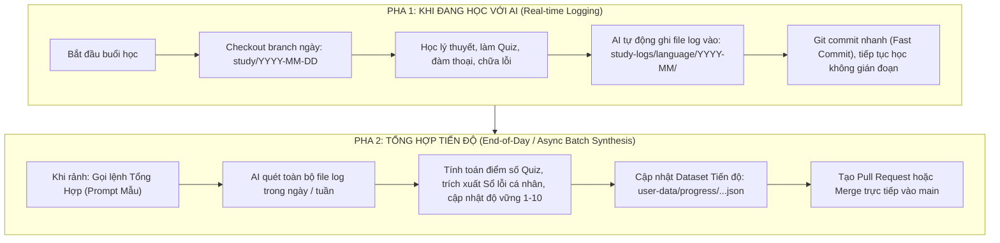

# Kiến Trúc Quản Lý Nhật Ký Học Tập (Study Logs) & Quy Trình Tổng Hợp Progress Tự Động

> **Mục tiêu:** Cung cấp quy trình 2 pha (Two-Phase Study Workflow) tinh gọn, giúp bạn thoải mái học cùng AI mỗi ngày mà không bị gián đoạn. AI tự động ghi chép log vào nhánh ngày (`study/YYYY-MM-DD`), sau đó tổng hợp vào Progress Dashboard vào cuối ngày hoặc khi bạn có thời gian rảnh.

---

## 1. Mô Hình Luồng Học Tập 2 Pha (The 2-Phase Study Flow)



---

## 2. Kiến Trúc Thư Mục Lưu Trữ Đề Xuất (`study-logs/`)

Toàn bộ nhật ký học tập sẽ được lưu tập trung tại thư mục gốc `study-logs/`, phân tầng theo **Ngôn ngữ** $\rightarrow$ **Tháng (YYYY-MM)** $\rightarrow$ **File ngày**:

```text
00.languages_docs/
├── study-logs/                         <-- Thư mục gốc chứa toàn bộ log học tập
│   ├── english/
│   │   ├── 2026-10/
│   │   │   ├── 2026-10-18_12-tenses-review.md
│   │   │   ├── 2026-10-18_inversion-and-emphasis.md
│   │   │   └── 2026-10-19_ielts-writing-task2-opinion.md
│   │   └── 2026-11/
│   ├── korean/
│   │   └── 2026-10/
│   │       ├── 2026-10-18_topik-advanced-grammar.md
│   │       └── 2026-10-19_korean-workplace-honorifics.md
│   └── README.md
├── user-data/                          <-- Dữ liệu tổng hợp cho Dashboard
│   └── progress/
│       ├── english-progress.json       <-- File JSON tổng hợp mới nhất cho English
│       └── korean-progress.json        <-- File JSON tổng hợp mới nhất cho Korean
└── apps/web/                           <-- Giao diện Web Dashboard hiển thị
```

### Tại sao nên cấu trúc như vậy?
1. **Độc lập theo ngôn ngữ:** Phù hợp với định hướng mở rộng đa ngôn ngữ (Tiếng Anh, Tiếng Hàn, Tiếng Nhật...).
2. **Gom theo tháng (`YYYY-MM`):** Tránh việc thư mục bị nghẽn (cluttered) khi số lượng bài học lên đến hàng trăm file sau 1 năm học.
3. **Quy tắc đặt tên file:** `YYYY-MM-DD_<topic-slug>.md` tự động sắp xếp theo trình tự thời gian tăng dần trong trình duyệt file và terminal.

---

## 3. Định Dạng File Log Chuẩn (Standard Study Log Template)

Mỗi file log sử dụng cấu trúc **Markdown kết hợp YAML Frontmatter**.
- **YAML Frontmatter (Máy/AI đọc):** Cấu trúc dữ liệu chặt chẽ để AI tự động trích xuất điểm số, lỗi sai và cập nhật thang 1-10 mà không bao giờ bị nhầm lẫn.
- **Markdown Body (Người học đọc):** Trình bày đẹp mắt, giải thích dễ hiểu (Anh - Việt - Hàn) để bạn mở điện thoại/laptop đọc lại trước khi đi ngủ.

```markdown
---
session_id: "20261018-en-tenses"
date: "2026-10-18"
language: "en"
domain: "grammar"
category: "12 thì & Thời gian"
topic_id: "grammar-tenses-past-perfect"
mentor: "Claude / ChatGPT / Antigravity"

attempts:
  - id: "attempt-20261018-01"
    title: "Bài kiểm tra tổng hợp Quá khứ hoàn thành & Hiện tại hoàn thành"
    correct: 8.5
    total: 10
    duration_minutes: 25
    note: "Nắm vững thì cơ bản, còn nhầm lẫn had + V3 với quá khứ đơn trong mệnh đề thời gian before/by the time"

errors:
  - id: "err-20261018-01"
    topic_id: "grammar-tenses-past-perfect"
    category: "12 thì & Thời gian"
    incorrect: "By the time he arrived, the train left."
    corrected: "By the time he arrived, the train had already left."
    explanation_vi: "Hành động tàu rời đi xảy ra trước thời điểm anh ấy đến trong quá khứ, bắt buộc dùng Quá khứ hoàn thành (had + V3)."
    explanation_ko: "기차가 떠난 행위가 그가 도착한 과거 시점보다 먼저 일어났으므로 과거완료(had + p.p.)를 써야 합니다."
    status: "due"

competency_update:
  topic_id: "grammar-tenses-past-perfect"
  previous_score: 5
  new_score: 7
  evidence: "Đã làm đúng 8.5/10 câu test phân biệt, giải thích đúng bản chất narrative time nhưng cần luyện thêm phản xạ tốc độ."

new_vocabulary:
  - word: "narrative time"
    cefr: "C1"
    meaning_vi: "thời gian trần thuật trong văn cảnh quá khứ"
    example: "Past perfect establishes anteriority in narrative time."
---

# Nhật Ký Học Tập: Ôn Tập 12 Thì & Quá Khứ Hoàn Thành
**Ngày học:** 18/10/2026  
**Chủ đề:** Past Perfect vs Past Simple & Narrative Time  

## 1. Tóm tắt nội dung đã học
- Phân biệt hành động xảy ra trước một mốc thời gian trong quá khứ (`before`, `by the time`).
- Công thức: `S + had + V3/ed`.

## 2. Chi tiết các câu hỏi sai & Phân tích chuyên sâu
### Câu 1:
- **Câu gốc sai:** *By the time he arrived, the train left.*
- **Câu sửa đúng:** *By the time he arrived, the train had already left.*
- **Ghi nhớ:** Cứ thấy mốc quá khứ (`arrived`) mà hành động kia đã xong trước thì 100% là `had + V3`.

## 3. Lộ trình ôn tập tiếp theo
- Ngày mai: Làm lại 5 câu biến thể có đảo ngữ với `Hardly... when...` và `No sooner... than...`.
```

---

## 4. Quy Trình Quản Lý Branch Theo Ngày (Daily Git Workflow)

### Bước 1: Khi bắt đầu học (Khởi tạo branch ngày)
Bạn hoặc AI tạo branch theo ngày:
```bash
git checkout main
git pull origin main
git checkout -b study/2026-10-18
```

### Bước 2: Trong khi học (Lưu file log và commit nhanh)
AI soạn file log vào `study-logs/english/2026-10/2026-10-18_tenses-review.md` và commit:
```bash
git add study-logs/
git commit -m "study(en): log session for past perfect & tenses review (2026-10-18)"
```
*(Bạn có thể học nhiều bài trong ngày, AI cứ tạo thêm file log và commit thêm vào cùng branch đó).*

### Bước 3: Cuối ngày hoặc hôm sau (Tổng hợp vào Progress)
Khi bạn sẵn sàng, gửi prompt tổng hợp cho AI. AI sẽ:
1. Đọc tất cả các file log trong ngày.
2. Cập nhật file `user-data/progress/english-progress.json`.
3. Kiểm thử build và tạo commit:
```bash
git add user-data/
git commit -m "chore(progress): aggregate study logs of 2026-10-18 into progress dashboard"
git checkout main
git merge study/2026-10-18
git push origin main
```

---

## 5. Hai Prompt Mẫu Chuẩn Dành Cho Bạn Khi Giao Tiếp Với AI

### 🎯 Prompt 1: Dùng khi BẮT ĐẦU BUỔI HỌC (Real-time Study & Logging)
> Copy đoạn này dán cho AI (ChatGPT / Claude / Antigravity):

```text
Hôm nay tôi muốn học về chủ đề [TÊN CHỦ ĐỀ, ví dụ: 12 thì tiếng Anh / IELTS Writing Task 2 / TOPIK Grammar].
Quy trình học và ghi chép:
1. Hãy tạo hoặc chuyển sang branch: study/[YYYY-MM-DD hôm nay].
2. Trong buổi học, hãy đặt câu hỏi, kiểm tra bài tập và giải thích chi tiết lỗi sai cho tôi (kèm giải thích tiếng Việt và tiếng Hàn nếu có).
3. Kết thúc buổi học, hãy tự động tạo một file log chuẩn theo template tại docs/STUDY_LOGS_AND_PROGRESS_WORKFLOW.md và lưu vào thư mục study-logs/[ngôn ngữ]/[YYYY-MM]/[YYYY-MM-DD]_[tên-chủ-đề].md.
4. Commit file log này vào branch với message: "study([ngôn ngữ]): log session [tên chủ đề]".
Bây giờ hãy bắt đầu bài học đầu tiên!
```

---

### 🚀 Prompt 2: Dùng CUỐI NGÀY hoặc HÔM KHÁC (Batch Synthesis into Dashboard)
> Khi bạn muốn AI tổng hợp tiến độ vào Dashboard:

```text
Tôi đã hoàn thành các buổi học. Hãy giúp tôi tổng hợp toàn bộ tiến độ vào Progress Dashboard:
1. Hãy đọc tất cả các file log mới trong thư mục study-logs/ trên branch study/[YYYY-MM-DD].
2. Trích xuất:
   - Các bài test (attempts) -> Thêm vào lịch sử học.
   - Các câu sai (errors) -> Thêm vào Sổ lỗi cá nhân với đầy đủ giải thích Việt - Hàn và trạng thái "due".
   - Đánh giá năng lực: Cập nhật điểm số (1-10) và bằng chứng (evidence) cho các topics tương ứng theo đúng bảng phân loại trong apps/web/src/features/english-progress/model.ts.
3. Xuất và cập nhật file dữ liệu tổng hợp tại user-data/progress/[ngôn ngữ]-progress.json.
4. Chạy kiểm tra "npm run type-check && npm run build" tại apps/web để đảm bảo dữ liệu hợp lệ.
5. Commit thay đổi và merge nhánh study/[YYYY-MM-DD] vào nhánh main, sau đó đẩy lên origin/main.
```
